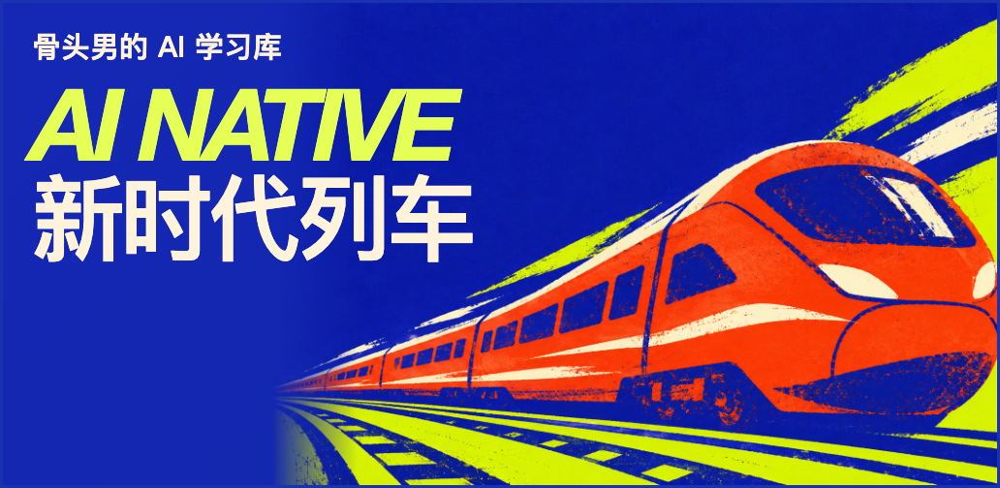

# 套色印刷海报

把主题做成少量色版、硬轮廓与印刷颗粒构成的强焦点海报。适合想要鲜明平面冲击力、又需要准确传达信息的创作。

将完整目录交给支持 Skill 的助手，使用 `$produce-screenprint-poster`，同时提供主题、原文、用途与尺寸。新增海报从构图和色版开始；修改已有稿时，附当前图和可编辑源，并说明只改哪里。

示例：请用这个 Skill 为城市阅读节做一张竖版海报。保留我提供的标题、日期与活动安排；主体和配色围绕阅读主题设计，文字独立排版，并交手机预览。

交付是实际海报、可编辑排版源及必要素材。运行时需要可用的图像工具与排版/导出能力；本包不附字体、服务账号或原始个人素材。

## 实际案例：AI Native 新时代列车（主视觉节选）

- **实际输入**：以“AI Native 新时代列车”为主题，结合“骨头男的 AI 学习库”品牌文字和列车主体制作宣传海报。
- **视觉处理**：用蓝底、橙红列车与荧光黄色建立有限色版对比，硬轮廓、油墨颗粒和向右的透视动势组织画面；标题留在左上。
- **检查结果**：标题完整可读，列车与文字分区，色版和颗粒在主体上清楚可辨。 此处展示已确认成图的上部主视觉节选，尺寸为1032×504；示例展示图像与文字的组织方式，完整海报的其他信息按任务另排。

## 海报制作与编辑

按本次内容与想要的视觉选择，保留已确认的主体和文字要求：

- [套色印刷海报](https://github.com/xupengli406-del/produce-screenprint-poster)：需要套色印刷、纸张颗粒和大色块视觉的图文或活动海报。
- [立体收藏玩具海报](https://github.com/xupengli406-del/produce-collectible-toy-poster)：需要立体玩具质感、清楚形体与空间层次的主题海报。
- [夜行电影海报](https://github.com/xupengli406-del/produce-night-cinema-poster)：需要夜景氛围、光影和场景叙事的电影感海报。
- [美漫斜切拼接封面](https://github.com/xupengli406-del/produce-comic-panel-cover)：需要把人物、场景或物件用斜切分镜组织起来的封面与海报。
