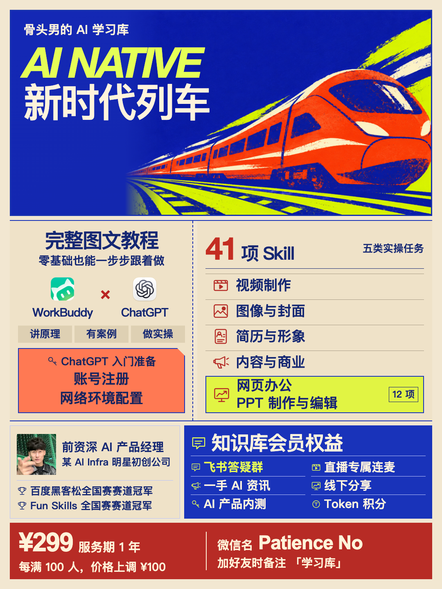

# 套色印刷海报

把主题做成少量色版、硬轮廓与印刷颗粒构成的强焦点海报。适合想要鲜明平面冲击力、又需要准确传达信息的创作。

将完整目录交给支持 Skill 的助手，使用 `$produce-screenprint-poster`，同时提供主题、原文、用途与尺寸。新增海报从构图和色版开始；修改已有稿时，附当前图和可编辑源，并说明只改哪里。

示例：请用这个 Skill 为城市阅读节做一张竖版海报。保留我提供的标题、日期与活动安排；主体和配色围绕阅读主题设计，文字独立排版，并交手机预览。

交付是实际海报、可编辑排版源及必要素材。运行时需要可用的图像工具与排版/导出能力；本包不附字体、服务账号或原始个人素材。

## 实际案例：AI Native 新时代列车（完整海报）

- **实际输入**：以“AI Native 新时代列车”为主题，将品牌、教程与 Skill 分类、会员权益、资历及用户确认的服务与联系文案编排为完整宣传海报。
- **视觉与版面**：蓝底、橙红列车和荧光黄色形成套色冲击；下方通过统一边线与高反差色块组织教程、分类、权益和行动信息。
- **实际输出与检查**：此处展示1080×1440的整张定稿，主视觉、标题、详情、服务条件与行动入口均包含在同一张图中。已查看完整成图，核对标题与关键主体的间隔、各组信息归属以及底部行动区的完整性。案例中的具体文案、人物、数量和模块只对应本次任务，后续按实际需求重排。

## 海报制作与编辑

按本次内容与想要的视觉选择，保留已确认的主体和文字要求：

- [套色印刷海报](https://github.com/xupengli406-del/produce-screenprint-poster)：需要套色印刷、纸张颗粒和大色块视觉的图文或活动海报。
- [立体收藏玩具海报](https://github.com/xupengli406-del/produce-collectible-toy-poster)：需要立体玩具质感、清楚形体与空间层次的主题海报。
- [夜行电影海报](https://github.com/xupengli406-del/produce-night-cinema-poster)：需要夜景氛围、光影和场景叙事的电影感海报。
- [美漫斜切拼接封面](https://github.com/xupengli406-del/produce-comic-panel-cover)：需要把人物、场景或物件用斜切分镜组织起来的封面与海报。
